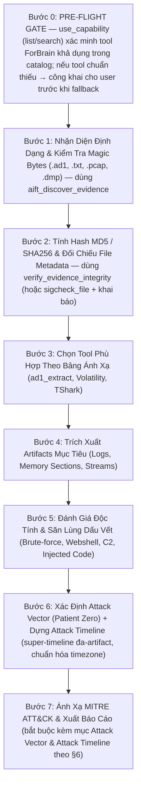

# V-AutoFor Digital Forensics & Incident Response (DFIR) Standard Operating Procedure

> [!CAUTION]
> **QUY TẮC BẮT BUỘC SỐ 1 - SỬ DỤNG TOOL MCP CHUYÊN DỤNG (KHÔNG DÙNG POWERSHELL / BASH):**
> 1. AI **TUYỆT ĐỐI KHÔNG** dùng lệnh PowerShell hoặc Bash thông thường (như `Get-Content`, `type`, `cat`, `dir`, `Select-String`,...) để đọc hay phân tích các tệp tin bằng chứng số. Các lệnh shell thông thường **không thể phân tích nhị phân chuẩn SANS FOR508** và **không gửi dữ liệu đo kiểm về ForBrain**.
> 2. Mọi thao tác phân tích tệp tin bằng chứng **BẮT BUỘC PHẢI GỌI CÁC CÔNG CỤ MCP CỦA FORBRAIN**:
>    - File `.ad1` ➔ Gọi `ad1_list` và `ad1_extract`.
>    - Hashing & Metadata `.txt` ➔ Gọi `verify_evidence_integrity`.
>    - File PE (`.exe`, `.dll`, `.sys`) ➔ Gọi `pe_analyze` và `sigcheck_file`.
>    - Windows Prefetch (`.pf`) ➔ Gọi `parse_prefetch`.
>    - Windows Amcache (`Amcache.hve`) ➔ Gọi `parse_amcache`.
>    - Windows Shimcache (`SYSTEM`) ➔ Gọi `parse_shimcache`.
>    - Bảng $MFT ➔ Gọi `parse_mft`.
>    - Windows Event Logs (`.evtx`) ➔ Gọi `parse_evtx`.
>    - Shellbags (`UsrClass.dat` / `NTUSER.DAT`) ➔ Gọi `parse_shellbags`.
>    - Shortcuts (`.lnk`) ➔ Gọi `parse_lnk`.
>    - Jumplists (`*Destinations-ms`) ➔ Gọi `parse_jumplists`.
>    - SRUM (`SRUDB.dat`) ➔ Gọi `parse_srum`.
>    - Linux Logs (`auth.log`, `syslog`, `.bash_history`) ➔ Gọi `analyze_linux_logs`.
>    - Memory Dump (`.raw`, `.dmp`, `.vmem`) ➔ Gọi `volatility_*`.
>    - Network PCAP (`.pcap`, `.pcapng`) ➔ Gọi `tshark_*`.
> 3. Mỗi lệnh gọi MCP Tool này sẽ **ngay lập tức bắn dữ liệu Telemetry về ForBrain (Port 5000)** để người dùng theo dõi và kiểm tra output trực tiếp theo thời gian thực!

> [!CAUTION]
> **QUY TẮC BẮT BUỘC SỐ 2 - PRE-FLIGHT GATE: XÁC MINH TOOL TRƯỚC KHI CHẠY, CẤM FALLBACK SHELL IM LẶNG:**
> **Bài học thực tế (case c46-FirstHack, 2026-11-10):** AI đã bỏ qua các tool ForBrain chuyên dụng (vì `ad1_list`, `verify_evidence_integrity`, `analyze_linux_logs` không có trong catalog lúc đó) và **tự động fallback sang PowerShell/Python đọc bằng chứng** mà KHÔNG thông báo cho người dùng → người dùng mất toàn bộ telemetry trên ForBrain Monitor (port 5000). Sai sót này bị nghiêm cấm tái diễn.
>
> 1. **Pre-Flight Gate (BUỘC trước khi phân tích bằng chứng):** AI phải gọi `use_capability(action="list")` hoặc `action="search"` để **xác minh các tool ForBrain cần dùng có thực sự đăng ký trong catalog** của phiên hiện tại. Không được giả định tool tồn tại chỉ dựa trên bảng ánh xạ ở §3.
> 2. **Ưu tiên bậc 1 — Tool chuẩn (phát telemetry ForBrain):** Nếu tool chuẩn trong §3 có mặt trong catalog → **BẮT BUỘC dùng nó**, không được thay bằng shell.
> 3. **Ưu tiên bậc 2 — Tool thay thế có telemetry (bảng §2.1):** Tool chuẩn thiếu → dùng tool thay thế trong bảng §2.1 (vẫn là MCP tool, vẫn bắn telemetry về ForBrain).
> 4. **Fallback shell — CHỈ khi không còn tool nào khả dụng:** Phải **KHAI BÁO TRƯỚC CHO NGƯỜI DÙNG trong chat** (dòng đầu tiên của bước đó), nêu rõ: (a) tool chuẩn nào bị thiếu, (b) đã search catalog ở bước Pre-Flight, (c) sẽ dùng shell tạm thời và vì sao. **TUYỆT ĐỐI KHÔNG fallback im lặng.**
> 5. **Báo cáo:** Trong báo cáo DFIR, mục Chain of Custody phải có mục **"Forensic Tooling & Telemetry"** liệt kê từng tool ForBrain đã gọi (tên tool, đường dẫn bằng chứng) và phần nào (nếu có) bị làm bằng shell + lý do.
>
> **Bảng §2.1 — Tool chuẩn ➔ Tool thay thế (cả hai đều là MCP ForBrain):**
>
> | Tool chuẩn (nếu có trong catalog) | Tool thay thế đã xác minh khả dụng | Áp dụng cho |
> | :--- | :--- | :--- |
> | `aift_discover_evidence` (server `aift`) | — (chính nó là tool phát hiện) | Phát hiện/định danh mọi bằng chứng trong thư mục (image, archive, binary) |
> | `ad1_list` / `ad1_extract` | `aift_discover_evidence` + `aift_start_triage` | Container `.ad1` / `.E01` |
> | `verify_evidence_integrity` | `sigcheck_file` / `extract_strings` + khai báo shell hash | Hashing & đối chiếu `.ad1.txt` |
> | `analyze_linux_logs` | `extract_strings` (băm nhị phân: `wtmp`, `lastlog`, `utmp`) + `aift_discover_evidence`; log text: đọc read-only và **khai báo trong chat** | `auth.log`, `syslog`, `wtmp`, `.bash_history` |
> | `pe_analyze` | `sigcheck_file` (PE header, entropy, hash, chữ ký) + `extract_strings` | `.exe`, `.dll`, `.sys` |
> | `parse_evtx` / `parse_prefetch` / `parse_amcache` / `parse_shimcache` / `parse_mft` / `parse_shellbags` | `run_zimmerman_tool` (chạy Zim tool bất kỳ) | Artifacts Windows |
> | `volatility_pslist` / `malfind` / `netscan` / `cmdline` / `pstree` | `volatility_run` (chạy plugin Volatility 3 bất kỳ) | RAM dump |
> | `tshark_*` | `tshark_filter` (display filter bất kỳ) | PCAP |
| `trigger_remote_triage` / `test_remote_target_connectivity` / `check_network_share_status` | `remote_triage` (MCP Server) | **Agent 02 Remote Acquisition**: Thu thập chứng cứ từ xa (RAM, PCAP, LiveState, CyLR) qua SMB Share |

This skill governs the autonomous and paired forensic investigation methodology of the **V-AutoFor** AI Platform. Whenever analyzing evidence, forensic samples, triage packages, memory dumps, or packet captures, the AI **MUST** rigorously follow this standard operating procedure.

---

## 1. International Forensic Standards & Frameworks

The AI agent must ground all analyses, hypotheses, and conclusions in recognized global standards:
* **ISO/IEC 27037 (Evidence Handling):** Strict guidelines for identification, collection, acquisition, and preservation of digital evidence (integrity, non-destructive read-only analysis, verifiable chain of custody).
* **RFC 3227 (Order of Volatility):** Always prioritize volatile evidence (RAM, network state) before non-volatile artifacts (disk, logs).
* **NIST SP 800-86:** Guide to Integrating Forensic Techniques into Incident Response.
* **SANS FOR508 & FOR500:** Advanced Incident Response, Threat Hunting, and OS Artifact Analysis.
* **MITRE ATT&CK Matrix for Enterprise:** Every discovered suspicious artifact must be mapped to its corresponding Tactic (`TA00xx`) and Technique (`Txxxx`).

---

## 2. Quy Trình 3 Bước Triage Đầu Tiên: Nhận Diện - Băm Hash - Đánh Giá Độc Tính

### BƯỚC 1: Xác Định Đây Là File Gì (File Format & Magic Bytes Identification)
Trước khi phân tích, AI phải xác định chính xác bản chất của file bằng chữ ký nhị phân (Magic Bytes / File Header) và file metadata đi kèm:
1. **Kiểm tra File Header / Magic Bytes:**
   - `.ad1`: Bắt đầu bằng chuỗi header `ADSEGMENTEDFILE` (AccessData FTK Imager Logical Image).
   - `.E01`: Header `EVF` (Expert Witness Format / EnCase).
   - `.pcap`: Magic bytes `d4 c3 b2 a1` hoặc `a1 b2 c3 d4`.
   - `.pcapng`: Magic bytes `0a 0d 0d 0a` (PCAP Next Generation).
   - `.dmp` / Memory Dump: Header `PAGEDUMP` (Windows Crash Dump) hoặc raw physical memory.
   - `.evtx`: Header `ElfFile\x00` (Windows Event Log).
   - `.pf`: Header `SCCA` (Windows Prefetch).
   - `PE / Executable`: Header `MZ` (`4D 5A`) tại offset 0.
   - `ELF / Linux binary`: Header `\x7fELF` (`7F 45 4C 46`).
2. **Đọc File Companion Metadata (.txt, .log, .info):**
   - File `.ad1.txt` hoặc `.E01.txt` được FTK Imager tạo ra tự động khi trích xuất.
   - Phải đọc file này để nắm:
     * Công cụ thu thập (FTK Imager version).
     * Bằng chứng nguồn (Source Partition, filesystem ext4, NTFS).
     * Các thư mục nguồn được trích xuất (Custom Content: e.g. `/boot`, `/var/log`, `/root`).
     * Checksum gốc do điều tra viên ghi nhận (MD5, SHA1).

---

### BƯỚC 2: Tính Toán & Xác Minh Hash (Integrity & Chain of Custody)
Tính toàn vẹn của bằng chứng là nguyên tắc bất di bất dịch trong Forensic:
1. **Tính toán đồng thời 3 hàm băm:**
   - **MD5:** Tương thích với các biên bản thu giữ cũ và FTK Imager report.
   - **SHA-1:** Kiểm tra toàn vẹn truyền thống.
   - **SHA-256:** Chuẩn hiện đại chống va chạm mã băm (NIST FIPS 180-4).
2. **Đối chiếu với Companion Metadata:**
   - So sánh MD5/SHA-1 vừa tính với dòng `[Computed Hashes]` trong file `.txt`.
   - Nếu khớp 100%: Xác nhận *"Evidence Integrity Verified - No tampering or corruption"*.
   - Nếu lệch: Phải cảnh báo nghi ngờ file bị hỏng hoặc bị sửa đổi trong quá trình truyền tải.

---

### BƯỚC 3: Đánh Giá Độc Tính Sơ Bộ (Malicious Triage & Threat Assessment)
AI thực hiện quét và săn lùng chỉ số độc hại theo các hướng:
1. **Đối với Artifact Log Linux (`auth.log`, `syslog`, `.bash_history`):**
   - **SSH Brute-Force:** Đếm số lần `Failed password for ... from <IP>`. Tìm dòng `Accepted password for root from <IP>` sau chuỗi brute-force.
   - **Web Shell & Backdoor:** Quét chuỗi nhạy cảm: `eval(base64_decode`, `system($_GET`, `passthru`, `c99`, `r57`, `b374k`, `weevely`.
   - **Persistence:** Kiểm tra `/etc/crontab`, `/var/spool/cron`, `/etc/rc.local`, systemd service lạ.
   - **Bash History Hunting:** Lệnh tải mã độc (`curl`, `wget`, `nc`, `python -c "import socket..."`), lệnh xóa vết (`history -c`, `rm -rf /var/log`, `shred`).
2. **Đối với Artifact Windows (EVTX, Registry, Prefetch):**
   - **Event ID 4625 (Failed Logon) ➔ 4624 (Logon Type 3/10):** Dấu hiệu Password Spraying hoặc Brute-Force.
   - **Event ID 7045 / 4697 (Service Installation):** Cài đặt Backdoor service.
   - **Event ID 4688 / Sysmon Event 1:** LOLBAS commands (`certutil -urlcache`, `bitsadmin /transfer`, `powershell -enc`).
3. **Đối với Memory Dump (RAM):**
   - Dùng `volatility_malfind` tìm tiến trình chứa shellcode `PAGE_EXECUTE_READWRITE`.
   - Dùng `volatility_pstree` tìm tiến trình mồ côi hoặc cha-con bất thường (`cmd.exe` đẻ từ `w3wp.exe` hoặc `word.exe`).
4. **Đối với Network PCAP:**
   - Dùng `tshark_dns_queries` tìm DGA, DNS Tunneling.
   - Dùng `tshark_http_requests` / `tshark_tls_sni` tìm C2 Beaconing (kết nối lặp lại theo chu kỳ với IP/domain đáng ngờ).

---

## 3. Bảng Ánh Xạ: Định Dạng File Nào ➔ Dùng Tool Gì (Format-to-Tool Matrix)

| Định dạng file | Loại bằng chứng | Công cụ tương ứng (MCP Tool) | Tool ForBrain thay thế (khi tool chính không có trong catalog) | Mục tiêu phân tích |
| :--- | :--- | :--- | :--- | :--- |
| **Mọi target trong thư mục bằng chứng** | Evidence discovery | `aift_discover_evidence` | — (chính nó là bước Pre-Flight) | Phát hiện/định danh toàn bộ bằng chứng (image, archive, binary) và hash list. |
| **`.ad1`** | Logical Container (FTK Imager) | `ad1_list`, `ad1_extract` | `aift_discover_evidence` + `aift_start_triage` | Đọc cấu trúc cây thư mục, bung toàn bộ file/log ra disk để phân tích. |
| **`.txt` / `.log` đi kèm** | Metadata Report | `verify_evidence_integrity` | `sigcheck_file` + khai báo shell hash trong chat | Lấy hash gốc, nguồn phân vùng, thời gian tạo, xác minh tính toàn vẹn ISO/IEC 27037. |
| **`.exe`, `.dll`, `.sys`** | PE Binaries / Malware | `pe_analyze`, `sigcheck_file` | `sigcheck_file` + `extract_strings` | Đọc PE header, section entropy (UPX/packer), imphash, kiểm tra chữ ký số. |
| **`.pf`** | Windows Prefetch | `parse_prefetch` | `run_zimmerman_tool` (PECmd.exe) | Đếm số lần thực thi, 8 mốc thời gian chạy gần nhất, DLLs được nạp (Evidence of Execution). |
| **`Amcache.hve`** | Windows Amcache | `parse_amcache` | `run_zimmerman_tool` (AmcacheParser.exe) | SHA-1 của chương trình, đường dẫn gốc, thời gian thực thi đầu tiên (First Execution). |
| **`SYSTEM` hive** | AppCompatCache | `parse_shimcache` | `run_zimmerman_tool` (AppCompatCacheParser.exe) | Lịch sử tương thích ứng dụng (1024 binary), kích thước file và timestamp. |
| **`$MFT`** | Master File Table | `parse_mft` | `run_zimmerman_tool` (MFTECmd.exe) | Phân tích MACB timestamps ($SI vs $FN) để phát hiện Timestomping, file bị xóa. |
| **`.evtx`** | Windows Event Log | `parse_evtx` | `run_zimmerman_tool` (EvtxECmd.exe) | Sự kiện đăng nhập (4624/4625), dịch vụ mới (7045), PowerShell 4104, Sysmon. |
| **`UsrClass.dat`, `NTUSER.DAT`** | Shellbags | `parse_shellbags` | `run_zimmerman_tool` / `parse_registry` (RECmd.exe) | Bằng chứng duyệt thư mục GUI trong Windows Explorer của kẻ tấn công. |
| **`.lnk`** | Shortcut Files | `parse_lnk` | `run_zimmerman_tool` (LNKParser.exe) | Đường dẫn file gốc, serial ổ đĩa, địa chỉ MAC của máy tạo shortcut. |
| **`*Destinations-ms`** | Jumplists | `parse_jumplists` | `run_zimmerman_tool` (JumplistParser.exe) | Lịch sử file vừa mở theo từng ứng dụng. |
| **`SRUDB.dat`** | SRUM | `parse_srum` | `run_zimmerman_tool` (SrumDbCmd.exe) | Lịch sử 30-60 ngày về lượng byte mạng gửi/nhận và thời gian chạy ứng dụng. |
| **`auth.log`, `syslog`, `.bash_history`** | Linux Logs | `analyze_linux_logs` | `extract_strings` (cho binary `wtmp`/`utmp`/`lastlog`) + `aift_discover_evidence`; log text: đọc read-only **KÈM khai báo cho user trong chat** | Tự động phát hiện SSH Brute-Force, leo quyền sudo, lệnh bash kẻ tấn công đã gõ. |
| **`.E01`, `.raw`, `.dd`, `.vmdk`** | Full Disk Image | `aift` (Dissect Engine) | `aift_discover_evidence` + `aift_start_triage` | Mở file hệ thống NTFS/ext4, phân tích partition table, mount filesystem. |
| **`.dmp`, `.vmem`, `.raw` (RAM)** | Memory Dump | `volatility_*` | `volatility_run` (plugin Volatility 3 bất kỳ) | `volatility_pslist`, `pstree`, `malfind`, `netscan`, `cmdline`. |
| **`.pcap`, `.pcapng`, `.cap`** | Network Capture | `tshark_*` | `tshark_filter` (display filter Wireshark bất kỳ) | `tshark_conversations`, `tshark_dns_queries`, `tshark_http_requests`, `tshark_tls_sni`. |
| **Persistence (Khởi động)** | Autostarts | `autoruns_triage` | `autoruns_triage` | Quét toàn bộ điểm cắm chốt Run/RunOnce, Services, Scheduled Tasks. |

> ⚠️ **Nguyên tắc đọc bảng:** Cột "Tool ForBrain thay thế" chỉ được dùng khi cột tool chính **không tồn tại trong catalog phiên** (đã kiểm tra ở Bước 0). Trong mọi trường hợp, tool được gọi PHẢI là MCP tool của ForBrain (aift / eztools / network_memory / sysinternals) — trừ khi không còn lựa chọn nào, lúc đó phải **khai báo công khai cho người dùng** (Quy tắc Bắt buộc Số 2).

---

## 4. Trình Tự Thực Hiện Forensic Step-by-Step

---

## 5. Quy Tắc Ứng Xử Chuyên Nghiệp Khi Điều Tra

* **Evidence-First Rule:** Tuyệt đối không phỏng đoán vô căn cứ. Mọi nhận định về kẻ tấn công phải trích dẫn bằng chứng cụ thể (dòng log, timestamp, IP nguồn, file path, hoặc hash).
* **Non-Destructive Principle:** Chỉ đọc bằng chứng trên bản sao hoặc phân tích Read-Only. Không bao giờ chỉnh sửa file gốc trong `E:\Hunting-Forensics\Evidence`.
* **Precision in Timestamps:** Mọi mốc thời gian sự kiện trong báo cáo phải ghi rõ timezone (ưu tiên `UTC` hoặc `UTC+7` ghi rõ).
* **Clear Attribution & IOCs:** Phân định rõ ràng giữa hành vi bình thường của hệ thống và hành vi xâm nhập có chủ đích của tin tặc.
* **Mandatory Tooling Disclosure (bắt buộc từ 2026-11-10):** Mọi báo cáo DFIR phải có mục **"Forensic Tooling & Telemetry"** trong Chain of Custody, liệt kê: (1) từng tool ForBrain đã được gọi cùng đường dẫn bằng chứng, (2) kết quả Pre-Flight Gate (tool nào có/mất trong catalog), (3) bất kỳ bước nào bị làm bằng shell + lý do + thời điểm. Mục đích: người dùng có thể đối chiếu 1:1 với telemetry trên ForBrain Monitor (port 5000).
* **Telemetry-Visible Work:** Ưu tiên tuyệt đối cho con đường phân tích mà người dùng **xem được trực tiếp trên ForBrain Monitor**. Nếu một artifact có thể phân tích bằng cả MCP tool lẫn shell, LUÔN chọn MCP tool.
* **Mandatory Attack Vector & Timeline & Evidence Register (bắt buộc từ 2026-11-10, case c46-FirstHack):** Mọi báo cáo DFIR PHẢI có (1) mục **"Attack Vector & Attack Path (Patient Zero)"** — trả lời rõ cửa ngõ xâm nhập, phân loại vector theo bảng §6.1, kill chain thực tế có trích dẫn bằng chứng cho TỪNG mắt xích; (2) mục **"Attack Timeline"** — bảng super-timeline đa-artifact theo §6.2; (3) **Evidence Register (bảng `E-##`) + Phụ lục Raw Tool Outputs verbatim** theo §6.3, và mọi dòng kết luận trong (1)–(2) phải gắn mã `E-##`. Thiếu một trong ba ➔ báo cáo bị coi là CHƯA HOÀN TẤT, dù 8 phần chuẩn đã đủ.

---

## 6. Phân Tích Attack Vector & Attack Timeline (Bắt Buộc Trong Mọi Báo Cáo)

### 6.1. Xác Định Attack Vector (Patient Zero → Attack Path)
Attack vector = "cửa ngõ + đường đi" mà tác nhân (kẻ tấn công HOẶC user hợp pháp) dùng để vào và thao tác trên hệ thống. Phân tích PHẢI trả lời đủ 3 câu hỏi:

1. **Patient Zero — điểm tiếp xúc sớm nhất:** Artifact nào chứa bằng chứng sớm nhất về sự xâm nhập/thao tác? Tìm theo thứ tự RFC 3227:
   RAM (netscan/cmdline/pslist) ➔ PCAP (gói tin đầu tiên) ➔ Security log (chuỗi `Failed password`➔`Accepted password`, EVTX 4625➔4624) ➔ MFT/USN ($FILE_NAME) ➔ syslog/auth.log, wtmp/btmp ➔ `.bash_history` (không có timestamp, dùng cuối).
2. **Phân loại vector** (chọn 1 hoặc nhiều, mỗi loại kèm bằng chứng cụ thể):

   | Vector | Dấu vết đặc trưng |
   | :--- | :--- |
   | Remote brute-force (SSH/RDP) | Chuỗi `Failed password for ... from <IP>` ➔ `Accepted password for <user> from <IP>` (auth.log / EVTX 4625➔4624) |
   | Phishing / malicious attachment | Process Office sinh shell, file trong Downloads/Temp, .lnk/.docx mới trong MFT, LNKParser target path |
   | Web shell / web vulnerability | File lạ trong webroot, webserver process sinh shell, HTTP request UA lạ / POST payload |
   | Lateral movement | PsExec/SCM (EVTX 7045), WMI (4688), WinRM (4037), SMB (4624 Type 3) |
   | Credential access / reuse | Pass-the-hash, LSASS access (RAM malfind), Mimikatz strings |
   | **Local abuse — user có quyền dùng tooling (kể cả CTF/lab)** | Session interactive (TTY `pts/0`, Logon Type 2), **KHÔNG** có failed logon, tooling thuộc về chính user (`~/.msf4`, `msfconsole` trong history), flag/hint CTF |

3. **Attack Path (kill chain thực tế):** Liệt kê chuỗi Tactic ➔ Technique đã xảy ra **theo đúng thứ tự**, mỗi mắt xích BẮT BUỘC có trích dẫn bằng chứng (tên file, dòng log, timestamp, hash). Mắt xích nào không có bằng chứng ➔ ghi *"Inconclusive — artifact missing"*, KHÔNG được suy diễn.

### 6.2. Dựng Attack Timeline (Super-Timeline đa-artifact)
1. **Thu thập mọi mốc thời gian** từ: RAM process start time, PCAP first/last packet, EVTX (4624/4625/4688/7045), MFT $FILE_NAME, syslog/auth.log, wtmp/btmp, `.bash_history` (trật tự lệnh).
2. **Chuẩn hóa timezone:** quy về 1 hệ (ưu tiên UTC). Log Linux syslog **không có năm và múi giờ** (vd `Mar 21 18:12:30`) ➔ suy luận năm từ: thời điểm acquire trong metadata FTK, log rotation (`.1`, `.2.gz`), kernel/package version (dpkg.log); **luôn đánh dấu rõ đây là suy luận**.
3. **Tương quan cross-artifact:** khớp sự kiện từ ≥2 nguồn độc lập (vd lệnh trong `.bash_history` ↔ dòng `sudo` trong `auth.log`) để nâng độ tin cậy; đánh dấu sự kiện chỉ có 1 nguồn; giải thích các gap (vd lệnh typo trỏ tới binary không tồn tại ➔ sudo không log).
4. **Định dạng báo cáo:** bảng 4 cột `Timestamp (ghi rõ múi) | Nguồn bằng chứng | Hành động | Chi tiết kỹ thuật`, sắp theo thời gian, nhóm theo phase (Initial Access / Post-Exploitation / Anti-forensics / Acquisition).
5. **Sự kiện không có timestamp** (vd `.bash_history`): tách riêng khu "Trật tự logic (không có timestamp)" ngay dưới bảng chính, kèm cơ sở suy luận thứ tự (số dòng history).

### 6.3. Evidence Register (Bảng Đăng Ký Bằng Chứng) & Phụ Lục Trích Xuất Gốc
Mọi kết luận về attack vector và timeline PHẢI truy vết ngược được về một bằng chứng cụ thể. Do đó mọi báo cáo DFIR phải có thêm:

1. **Bảng Evidence Register** (đặt ngay trước Attack Vector): đánh số từng bằng chứng `E-##`, mỗi hàng gồm:
   | `ID` | `Bằng chứng (file + vị trí: dòng/offset/record)` | `Tool ForBrain đã chạy` | `Output trích (hash, dòng log, record)` | `Kết luận nó ủng hộ` (Vector / Timeline / CoC) | `Lý do (1 câu: vì sao artifact này đủ mạnh để kết luận)` |
   - Một bằng chứng có thể ủng hộ nhiều kết luận (ghi nhiều mã), nhưng **mỗi kết luận quan trọng phải có ≥1 bằng chứng; mỗi bằng chứng đăng ký phải được trích dẫn ít nhất 1 lần ở phần phân tích** — không đăng ký bằng chứng "treo".
   - Bằng chứng loại trừ (vd: "không tìm thấy `Failed password`" cũng là bằng chứng — nó loại vector brute-force) **cũng phải đăng ký** với cột kết luận dạng `Loại trừ: <vector>`.
2. **Phụ lục: Raw Tool Outputs** — trích xuất **verbatim** (không tóm tắt, không cắt bỏ dòng nào của tool) output của TỪNG tool đã gọi, gắn nhãn `E-##` khớp Evidence Register. Mục đích: người dùng/thẩm định có thể đối chiếu 1:1 với telemetry ForBrain Monitor và tự kiểm chứng kết luận.
3. **Quy tắc liên kết:** Trong Attack Vector (§6.1) và Attack Timeline (§6.2), mỗi dòng kết luận/kết luận-then chốt phải có mã `E-##` ở cột Bằng chứng. Không mã ➔ dòng đó bị coi là suy diễn.
4. **Tách bạch 3 lớp:** (a) *Raw output* (phụ lục, verbatim) ➔ (b) *Bằng chứng đã chọn lọc + lý do* (Evidence Register) ➔ (c) *Kết luận* (Attack Vector/Timeline/CoC). Không được gộp (a) thẳng vào (c) mà bỏ qua (b).
