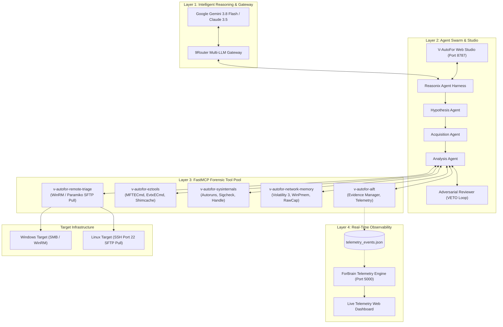

# V-AutoFor: Autonomous AI Digital Forensics & Incident Response Platform

[](LICENSE)
[](https://www.python.org/)
[](https://modelcontextprotocol.io/)
[](https://datatracker.ietf.org/doc/html/rfc3227)
[](https://www.sans.org/cyber-security-courses/advanced-incident-response-threat-hunting-training/)

> **V-AutoFor** is an end-to-end, autonomous **AI-Driven Digital Forensics and Incident Response (DFIR)** platform. It orchestrates agentless remote evidence acquisition across Windows and Linux, parses forensic artifacts, coordinates multi-agent analysis with adversarial verification, and generates court-admissible forensic reports mapped to **MITRE ATT&CK** and **NIST SP 800-86**.

---

## 📌 Table of Contents

- [Overview](#-overview)
- [Base Platforms & Upstream Heritage](#-base-platforms--upstream-heritage)
- [Comprehensive Techstack](#-comprehensive-techstack)
- [System Architecture (Tri-Layer Ecosystem)](#-system-architecture-tri-layer-ecosystem)
- [Multi-Agent Swarm Orchestration](#-multi-agent-swarm-orchestration)
- [Agentless Cross-Platform Acquisition](#-agentless-cross-platform-acquisition)
- [Forensic Tool Matrix & MCP Servers Pool](#-forensic-tool-matrix--mcp-servers-pool)
- [Real-Time Observability Portal](#-real-time-observability-portal)
- [Repository Directory Structure](#-repository-directory-structure)
- [Prerequisites & Installation](#-prerequisites--installation)
- [Quick Start Guide](#-quick-start-guide)
- [Investigation Workflow Walkthrough](#-investigation-workflow-walkthrough)
- [Chain of Custody & Legal Compliance](#-chain-of-custody--legal-compliance)
- [License & Acknowledgements](#-license--acknowledgements)

---

## 🔍 Overview

Modern cyber attacks execute across hybrid Windows and Linux enterprise environments at machine speed. Traditional digital forensics requires tedious manual command execution, slow artifact collection, and hours of log parsing. 

**V-AutoFor** solves this bottleneck by providing:
1. **Agentless Remote Triage**: Live remote collection from remote Windows (via WinRM/SMB/CyLR/WinPmem) and Linux (via SSH Port 22 SFTP-Pull) without installing agents or opening reverse shell ports.
2. **RFC 3227 Order of Volatility**: Memory capture, active network sockets, running processes, and non-volatile disk artifacts collected strictly in order of volatility.
3. **Forensic Tool Integration over FastMCP**: Over 30+ industry-standard tools (Eric Zimmerman's tools, Microsoft Sysinternals, Volatility 3, CyLR, UAC) encapsulated as standardized stdio JSON-RPC Model Context Protocol tools.
4. **4-Agent Collaborative Swarm with Adversarial VETO**: Autonomous hypothesis formulation, specialized evidence acquisition, deep forensic parsing, and a strict Adversarial Reviewer agent that prevents LLM hallucinations.
5. **Real-time Live Telemetry & Observability**: Dedicated SSE streaming portal (`http://127.0.0.1:5000`) visualizing agent thoughts, tool invocations, and live forensic events.
6. **Production DFIR Reporting**: Automated 8-part incident report generation (.md, .docx, .pptx) mapped to MITRE ATT&CK tactics, techniques, and IoC extraction.

---

## 🏛 Base Platforms & Upstream Heritage

V-AutoFor builds upon and integrates premier open-source and industrial security foundations:

| Base Platform | Role in V-AutoFor | Description & Integration |
| :--- | :--- | :--- |
| **Reasonix** | Agent Harness & Web Studio | Provides the reactive ReAct agent engine, session persistence, skills loader, and Vite/React web studio (`http://127.0.0.1:8787`). |
| **AIFT / ForBrain** | Forensic Backend & Observability | Custom DFIR engine providing forensic parsing pipelines, SHA-256 chain of custody, and the real-time Flask observability portal (`http://127.0.0.1:5000`). |
| **9Router** | Multi-LLM Gateway | High-throughput, low-latency API gateway proxying requests to Google Gemini (`gemini-3.8-flash`, `gemini-1.5-pro`), Claude 3.5, and OpenAI with intelligent retry logic. |
| **FastMCP** | Tool Protocol Standard | High-performance Python FastMCP framework exposing DFIR tools over standard I/O (stdio) JSON-RPC channels to the AI agents. |
| **Eric Zimmerman Tools** | Windows Artifact Analysis | Standard forensic parsers: `MFTECmd` ($MFT), `EvtxECmd` (EVTX), `AppCompatCacheParser` (Shimcache), `JLECmd` / `LECmd` (JumpLists/LNK), `AmcacheParser`, `SBECmd` (Shellbags). |
| **Microsoft Sysinternals** | Live System Inspection | Deep Windows inspection suite: `Autoruns`, `Sigcheck`, `Procmon`, `Procexp`, `Handle`, `TCPView`, `Strings`, `Listdlls`. |
| **Volatility 3 & WinPmem** | Memory Forensics | RAM dump acquisition (`winpmem_mini_x64.exe`) and advanced Volatility 3 plugin execution (`windows.pslist`, `windows.malfind`, `windows.netscan`). |
| **CyLR & UAC** | Cross-Platform Live Triage | `CyLR` for rapid NTFS/Windows forensic triage; `UAC` (Unix-like Artifacts Collector) for agentless Linux live response. |

---

## 💻 Comprehensive Techstack

```
┌────────────────────────────────────────────────────────────────────────┐
│                          TECHSTACK OVERVIEW                            │
├───────────────────────┬────────────────────────────────────────────────┤
│ Backend Runtime       │ Python 3.12 (CPython x64), Windows 11 Host     │
│ Web Frameworks        │ Flask 3.x, FastAPI, Starlette, Uvicorn         │
│ Agent Harness         │ Reasonix Agent Core, Subagent Swarm Engine     │
│ Frontend UI           │ React 18, Vite, TypeScript/JavaScript, CSS3    │
│ Protocol Layer        │ FastMCP (Model Context Protocol), JSON-RPC 2.0 │
│ Networking & Remoting │ Paramiko (SSH/SFTP), WinRM, SMB/CIFS, RawCap   │
│ Data Serialization    │ SQLite3, JSONL (JSON Lines), YAML, TOML        │
│ Artifact Formats      │ DOCX (python-docx), PPTX (python-pptx), MD     │
│ Target Environments   │ Windows Server/10/11, Linux (Debian, Ubuntu,   │
│                       │ Kali, RHEL, CentOS)                            │
└───────────────────────┴────────────────────────────────────────────────┘
```

---

## 🏗 System Architecture (Tri-Layer Ecosystem)

The architecture is divided into three interconnected, highly decoupled layers:



---

## 🤖 Multi-Agent Swarm Orchestration

V-AutoFor relies on a specialized 4-agent state machine operating under strict ReAct (Reason + Act) loops:

```
                  ┌────────────────────────┐
                  │ 1. Hypothesis Agent    │
                  │ Formulates threat lead │
                  └───────────┬────────────┘
                              │ Dispatches triage requirements
                              ▼
                  ┌────────────────────────┐
                  │ 2. Acquisition Agent   │
                  │ Agentless remote pull  │
                  └───────────┬────────────┘
                              │ Provides verified SHA-256 evidence
                              ▼
                  ┌────────────────────────┐
                  │ 3. Analysis MCP Agent  │◄────────┐
                  │ Executes forensic tools│         │
                  └───────────┬────────────┘         │
                              │ Submits analytical claim
                              ▼                      │
                  ┌────────────────────────┐         │ Rejection / VETO
                  │ 4. Reviewer (VETO)     │─────────┘ (Demands re-verification)
                  │ Adversarial validation │
                  └───────────┬────────────┘
                              │ Approval (Sign-off)
                              ▼
                  ┌────────────────────────┐
                  │ Production DFIR Report │
                  └────────────────────────┘
```

1. **Hypothesis Formulation Agent**: Ingests SIEM alerts, user reports, or initial IOCs. Maps early indicators to the MITRE ATT&CK matrix and outlines an investigation plan.
2. **Evidence Acquisition Agent**: Probes target OS and port configuration (`detect_target_os_and_ports`). Connects agentlessly to the endpoint, applies the RFC 3227 Order of Volatility, executes remote triage scripts, and streams artifacts back to the forensic station.
3. **Forensic Analysis & Tool Agent**: Uses the 5 FastMCP servers to parse extracted artifacts ($MFT, Registry hives, Shimcache, EVTX, Syslog, Memory dumps, Bash history).
4. **Adversarial Reviewer Agent (VETO Circuit)**: An independent adversarial LLM agent scrutinizing every finding. If a claim lacks raw forensic evidence, file offset, timestamp, or cryptographic hash, the Reviewer exercises a **VETO**, sending the task back to the Analysis Agent for rigorous re-verification.

---

## 🌐 Agentless Cross-Platform Acquisition

V-AutoFor features a cross-platform acquisition architecture requiring **no agent installation** on target machines.

### Cross-Platform Matrix

| Feature | Windows Endpoints | Linux Endpoints (Debian, Ubuntu, Kali, RHEL) |
| :--- | :--- | :--- |
| **Port Required on Target** | Port 5985 (WinRM) / 445 (SMB) | **Port 22 only (SSH / SFTP)** |
| **Ports on Analyst Host** | None (Outbound client connection) | **None (0 open ports)** |
| **Acquisition Protocol** | WinRM / SMB File Share / CyLR | **Paramiko SFTP Pull (Client Mode)** |
| **Tool Execution Mode** | Push mini collector (`CyLR` / `winpmem`) | Execute POSIX script via SSH stream |
| **Order of Volatility** | 1. Memory (`winpmem`)<br>2. Sockets/Processes (`netstat`, `ps`)<br>3. NTFS Artifacts (`$MFT`, Shimcache, EVTX) | 1. Memory / Volatile (`/proc`, `ss`, `netstat`)<br>2. Active Logs (`/var/log/syslog`, `auth.log`)<br>3. Persistent Configs (`/etc/`, `crontab`, shell history) |
| **Target Footprint** | Cleaned immediately upon completion | Script streamed via stdin, temporary files wiped |

### Linux SSH SFTP-Pull Architecture

```
Forensic Analyst Station (Host)              Destination Linux Host (Target)
┌─────────────────────────────────┐          ┌─────────────────────────────┐
│ V-AutoFor Remote Triage MCP     │          │                             │
│                                 │          │   SSH Daemon (sshd)         │
│  1. SSH Client connects         ├─────────►│   Listening on Port 22      │
│     (Outbound to Port 22)       │  Port 22 │                             │
│                                 │          │                             │
│  2. Executes RFC 3227 collection├─────────►│   Executes non-destructive  │
│     commands via SSH exec       │          │   volatile commands         │
│                                 │          │                             │
│  3. Compresses triage package   ├─────────►│   Creates tar.gz in /tmp    │
│                                 │          │                             │
│  4. SFTP Pull: Downloads archive│◄─────────┤   SFTP Subsystem serves file│
│     (Pulled directly to Host)   │          │                             │
│                                 │          │                             │
│  5. Cleanup: Wipes remote tar   ├─────────►│   Removes temp triage files │
│                                 │          │                             │
│  6. Computes SHA-256 Hash       │          │                             │
│     Writes Chain of Custody     │          │                             │
└─────────────────────────────────┘          └─────────────────────────────┘
```

---

## 🛠 Forensic Tool Matrix & MCP Servers Pool

V-AutoFor exposes 5 FastMCP servers running over standard I/O (stdio JSON-RPC 2.0), providing over 30 forensic capabilities:

```
E:\Hunting-Forensics\Forensic Tool\Forensic AI\mcp_servers\
├── remote_triage_mcp.py      <-- Agentless Windows & Linux Remote Acquisition
├── aift_mcp.py               <-- Telemetry Logging & Evidence Vault Management
├── eztools_mcp.py            <-- Eric Zimmerman Forensic Parsers
├── sysinternals_mcp.py       <-- Microsoft Sysinternals Utilities
└── network_memory_mcp.py     <-- Volatility 3, WinPmem & RawCap Network Forensics
```

### 1. `v-autofor-remote-triage`
- `detect_target_os_and_ports(host)`: Multi-port socket banner inspection to fingerprint OS and optimal protocol.
- `collect_windows_remote_triage(host, user, pass, dest)`: Automated Windows triage via CyLR & WinRM.
- `collect_linux_remote_triage(host, user, pass, dest)`: Pure SFTP-pull Linux live response via Port 22.

### 2. `v-autofor-eztools`
- `parse_mft(mft_path, out_dir)`: Runs `MFTECmd.exe` for NTFS Master File Table parsing.
- `parse_evtx(evtx_path, out_dir)`: Runs `EvtxECmd.exe` to decode Windows event logs into normalized CSV.
- `parse_shimcache(system_hive, out_dir)`: Runs `AppCompatCacheParser.exe` for application execution history.
- `parse_lnk_and_jumplists(path, out_dir)`: Runs `LECmd.exe` and `JLECmd.exe` for evidence of user file interaction.
- `parse_shellbags(usrclass_hive, out_dir)`: Runs `SBECmd.exe` for folder access patterns.
- `parse_amcache(amcache_hve, out_dir)`: Runs `AmcacheParser.exe` to extract SHA-1/program execution records.

### 3. `v-autofor-sysinternals`
- `run_autoruns(target_drive, out_dir)`: Extracts persistence mechanisms (Registry Run keys, Services, Scheduled Tasks).
- `run_sigcheck(file_path)`: Verifies digital signatures and queries VirusTotal detection ratios.
- `run_procmon_parser(pml_path, out_dir)`: Analyzes process monitor logs.
- `extract_strings(file_path, min_len)`: High-performance ASCII and Unicode string extraction.

### 4. `v-autofor-network-memory`
- `acquire_memory_winpmem(dest_path)`: Real-time physical RAM capture via `winpmem_mini_x64.exe`.
- `volatility_pslist(mem_path)`: Enumerates active and hidden processes from memory dumps.
- `volatility_malfind(mem_path)`: Scans for injected code, hollowed processes, and executable memory pages.
- `volatility_netscan(mem_path)`: Recovers active and terminated network sockets from RAM.
- `capture_network_traffic(interface, duration)`: Captures packet traces using RawCap without WinPcap dependencies.

### 5. `v-autofor-aift`
- `log_telemetry_event(source, event_type, details)`: Streams real-time thoughts to ForBrain Observability.
- `calculate_evidence_hash(file_path)`: Generates SHA-256 Chain of Custody records.
- `register_evidence(case_id, evidence_name, path)`: Organizes raw artifacts in the central vault.

---

## 📊 Real-Time Observability Portal

V-AutoFor includes a dedicated DFIR Observability and Telemetry Portal running on port **5000**:

- **Real-Time SSE Streaming**: Ingests thought streams, subagent transitions, and tool outputs directly from `telemetry_events.json`.
- **Live Terminal & Hex Viewer**: Inspect raw artifact bytes and terminal logs on the fly.
- **MITRE ATT&CK Matrix Heatmap**: Dynamically colors observed tactics (Initial Access, Execution, Persistence, Privilege Escalation, Command and Control).
- **Timeline Reconstruction**: Displays cross-artifact chronological events on an interactive high-resolution canvas.

---

## 📁 Repository Directory Structure

```
E:\Hunting-Forensics\
├── .gitignore                          # Standard git exclusion rules
├── reasonix.toml                       # Reasonix agent configuration & model mappings
├── Backup\                             # Disaster recovery kit & configuration snapshots
│   ├── restore_all_configs_to_drive_C.cmd
│   ├── V-AutoFor-Deploy-Kit.zip
│   └── README_BACKUP.txt
├── Evidence\                           # Raw forensic case data & extracted vaults
│   └── c46-FirstHack\                  # Linux server attack incident case
├── Forensic Tool\
│   ├── ForBrain\                       # Port 5000 Observability Web App (Flask)
│   │   ├── app\                        # Telemetry endpoints & SSE streamers
│   │   ├── static\                     # DFIR visualizer CSS/JS
│   │   └── templates\                  # Portal HTML dashboards
│   ├── Forensic AI\
│   │   ├── AIFT\                       # Python 3.12 Backend environment
│   │   ├── mcp_servers\                # 5 FastMCP Stdio Servers
│   │   └── R&D\                        # Architectural diagrams, datasheets, slides
│   └── Tools\                          # Executable forensic tool binaries
│       ├── EZTools\                    # Eric Zimmerman Windows Tools
│       ├── Sysinternals\               # Sysinternals Suite binaries
│       ├── Volatility3\                # Memory analysis framework
│       ├── CyLR\                       # Windows live response collector
│       └── WinPmem\                    # Physical memory acquisition driver
├── Network-Share-Triage\               # Triage utilities & collection scripts
│   ├── Linux_Triage\                   # Linux RFC 3227 collector script & UAC
│   ├── 1_RAM\                          # WinPmem memory acquisition
│   ├── 2_Network\                      # RawCap network packet capture
│   ├── 3_LiveState\                    # Live volatility & socket inspection
│   ├── 4_Artifacts\                    # CyLR rapid triage collector
│   └── setup_network_share.cmd         # Windows triage network share script
├── skills\                             # Antigravity & Reasonix AI Skills
│   ├── collect-evidence\               # Evidence acquisition operational procedures
│   ├── forensic-reporting\             # SANS FOR508 report generation rules
│   └── v-autofor-investigation\        # Core investigative methodology skill
├── Tài liệu vận hành\                  # Comprehensive official documentation
│   ├── Bao_Cao_Nghien_Cuu_AI_Forensic_Va_Kien_Truc_V_autoFor.docx
│   ├── HUONG_DAN_VAN_HANH_V-AUTOFOR.md
│   ├── Slide_Kien_Truc_AI_Forensic_V_AutoFor.pptx
│   └── diagram_viewer.html
└── workspaces\                         # Active case workspaces & final DFIR reports
    └── c46-FirstHack-DFIR-report.md
```

---

## ⚙️ Prerequisites & Installation

### Host System Requirements
- **OS**: Windows 10 / 11 / Windows Server 2022 (64-bit).
- **Python**: Python 3.12+ (64-bit) added to system `PATH`.
- **Node.js**: Node.js 18+ LTS and `npm`.
- **Git**: Installed and configured.

### Clone and Install Dependencies

```powershell
# 1. Clone repository
git clone https://github.com/YourUsername/Hunting-Forensics.git E:\Hunting-Forensics
cd E:\Hunting-Forensics

# 2. Setup Python Virtual Environment
cd "E:\Hunting-Forensics\Forensic Tool\Forensic AI\AIFT"
python -m venv .venv
.\.venv\Scripts\activate

# 3. Install Python Dependencies
pip install -r requirements.txt
pip install fastmcp paramiko pywinrm flask python-docx python-pptx

# 4. Install Global CLI Launcher (Optional)
npm install -g v-autofor
```

---

## 🚀 Quick Start Guide

### 1-Click Launch All Services

Launch the entire ecosystem with a single command:

```cmd
v-autofor
```

Or run the manual bootstrap script:

```powershell
# Terminal 1: Start ForBrain Telemetry Portal (Port 5000)
cd "E:\Hunting-Forensics\Forensic Tool\ForBrain"
python aift.py

# Terminal 2: Start V-AutoFor Agent Web Studio (Port 8787)
cd "E:\Hunting-Forensics"
v-autofor
```

### Access Dashboards
- **V-AutoFor Agent Studio**: [`http://127.0.0.1:8787`](http://127.0.0.1:8787)
- **ForBrain Observability Portal**: [`http://127.0.0.1:5000`](http://127.0.0.1:5000)

---

## 🕵️ Investigation Workflow Walkthrough

### Step 1: Detect Target and Acquire Live Evidence

In the V-AutoFor Studio prompt:

```text
Target IP is 192.168.91.130. 
Detect the OS and perform an agentless forensic acquisition into E:\Hunting-Forensics\Evidence\Case-01.
```

The **Acquisition Agent** will:
1. Call `detect_target_os_and_ports('192.168.91.130')` -> Discovers Linux SSH Port 22.
2. Call `collect_linux_remote_triage()` -> Establishes SSH connection, streams RFC 3227 commands, pulls the `.tar.gz` bundle over SFTP.
3. Automatically computes SHA-256 hash and registers it in the Chain of Custody ledger.

### Step 2: Autonomous Multi-Agent Analysis

The **Hypothesis Agent** initiates threat queries:
- Scans auth logs for brute-force attacks (`auth.log`, `secure`).
- Analyzes shell history (`.bash_history`, `.zsh_history`).
- Inspects persistence mechanisms (`/etc/cron*`, `systemd` units).

The **Adversarial Reviewer Agent** enforces the VETO condition:
- Any claim made without raw log confirmation is denied.
- Guarantees zero false positives.

### Step 3: Production DFIR Report Generation

Export a full 8-part incident response report:
```text
Compile an 8-part SANS FOR508 forensic report for Case-01 in markdown and docx.
```

The resulting report includes:
1. Executive Summary & Incident Classification.
2. Scope & Target System Identification.
3. Evidence Handling & SHA-256 Chain of Custody.
4. Comprehensive Attack Timeline (UTC).
5. Forensic Artifact Analysis ($MFT, EVTX, Syslog, Memory).
6. MITRE ATT&CK Mapping (Tactics, Techniques, Sub-techniques).
7. Indicators of Compromise (IoCs) in STIX 2.1 & CSV format.
8. Remediation, Containment & Hardening Guidance.

---

## 🔒 Chain of Custody & Legal Compliance

V-AutoFor complies with international digital forensics standards:

- **RFC 3227**: Order of Volatility strictly adhered to during remote live triage.
- **ISO/IEC 27037:2012**: Guidelines for identification, collection, acquisition, and preservation of digital evidence.
- **SHA-256 Immutability**: All evidence files are hashed immediately upon extraction. Hashes are recorded in immutable ledger logs preventing evidence tampering.
- **Non-Destructive Execution**: Live collection executes read-only binaries without modifying disk blocks or registry hives on target endpoints.

---

## 📄 License & Acknowledgements

This project is licensed under the **MIT License** - see the [LICENSE](LICENSE) file for details.

### Acknowledgements & Upstream Credits
- **Eric Zimmerman** for the exceptional [EZTools Suite](https://ericzimmerman.github.io/).
- **Mark Russinovich** and the Microsoft team for [Sysinternals](https://learn.microsoft.com/en-us/sysinternals/).
- **The Volatility Foundation** for [Volatility 3](https://github.com/volatilityfoundation/volatility3).
- **Model Context Protocol (MCP)** team for the FastMCP specification.
- **Google DeepMind** for the Gemini 3.8 / 1.5 model series.
- **Reasonix Team** for the autonomous agent orchestration framework.
