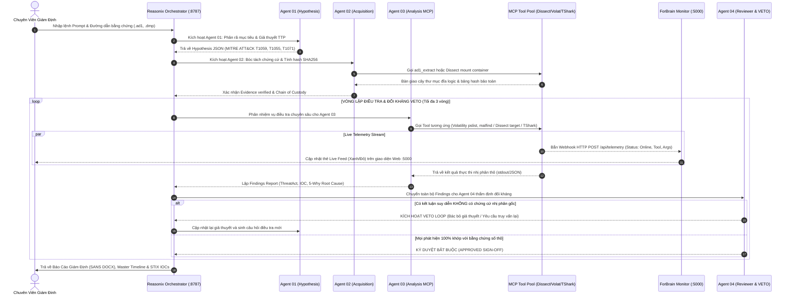
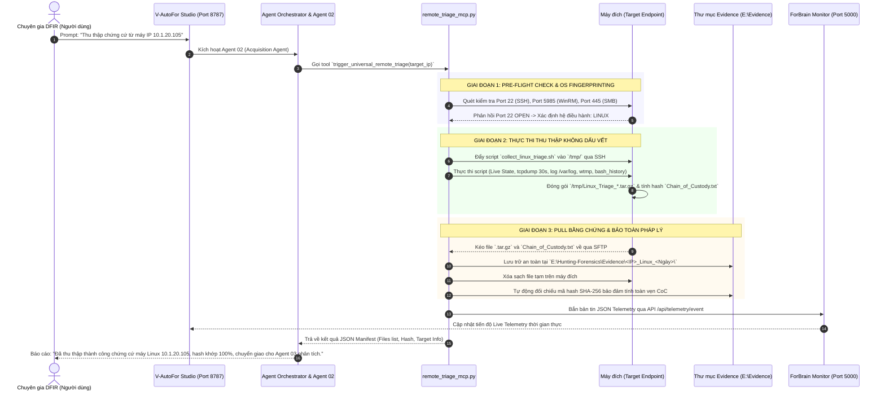

# BÁO CÁO GIẢI PHÁP & HƯỚNG DẪN VẬN HÀNH NỀN TẢNG AI FORENSIC V-AUTOFOR
## TÍCH HỢP TOÀN DIỆN 4 AGENTS, 9ROUTER, FORBRAIN OBSERVABILITY, SANS FOR508 VÀ BỘ FASTMCP

**Nền tảng Điều tra số & Ứng cứu sự cố An toàn thông tin (DFIR) Thông minh Hàng đầu**  
*Chuẩn hóa theo ISO/IEC 27037, NIST SP 800-86, SANS FOR508/FOR500 & MITRE ATT&CK Enterprise Matrix*

---

## 1. TỔNG QUAN KIẾN TRÚC TAM GIÁC: 9ROUTER ↔ V-AUTOFOR ↔ FORBRAIN

Hệ thống **V-AutoFor** vận hành theo mô hình kiến trúc tam giác phân tách vai trò độc lập, bảo đảm tính minh bạch, an toàn tuyệt đối và hiệu năng tối ưu:

```text
               ┌────────────────────────────────────────────────────────┐
               │         9Router Local Gateway (Port 20128)             │
               │   - Quản lý API Key (Gemini, DeepSeek, GPT-4o, Groq)   │
               │   - Cân bằng tải, Failover, Rate-limit, Proxy OpenAI   │
               └───────────────────────────▲────────────────────────────┘
                                           │ API Call (HTTP JSON /v1)
                                           ▼
┌──────────────────────────────────────────────────────────────────────────────────┐
│                   V-AutoFor AI Studio & Reasoning Engine (Port 8787)             │
│   - Điều tra viên AI Trí tuệ cao (4 Agents: Hypothesis, Acquisition, Analysis,    │
│     Adversarial Reviewer với VETO Loop tối đa 3 vòng)                            │
│   - Nhận diện chứng cứ, lập luận TTP, bóc tách container AD1                     │
│   - Bắt buộc gọi FastMCP Tool, CẤM tuyệt đối dùng shell thô                      │
└───────────────────────┬──────────────────────────────────▲───────────────────────┘
                        │ stdio JSON-RPC IPC               │
                        ▼                                  │
┌──────────────────────────────────────────────────────┐   │ Live Telemetry Webhook
│           Cụm 4 FastMCP Servers (>40 Tools)          │   │ (HTTP POST /api/telemetry)
│   - aift_mcp: Dissect Core & Đĩa vật lý              │   │
│   - eztools_mcp: Eric Zimmerman, PE, Linux Logs      │───┼──────────────┐
│   - sysinternals_mcp: Autoruns, Sigcheck, Handles    │   │              │
│   - network_memory_mcp: Volatility 3, TShark, AD1    │   │              │
└──────────────────────────────────────────────────────┘   │              │
                                                           │              ▼
                               ┌──────────────────────────────────────────────────┐
                               │     ForBrain Observability Monitor (Port 5000)   │
                               │   - Giám sát Tool Registry thời gian thực        │
                               │   - Live AI Execution Feed (Trực quan hóa thẻ)   │
                               │   - Inspect Raw Output & Báo cáo giám định       │
                               │   - Quản lý kho bằng chứng E:\Hunting-Forensics  │
                               └──────────────────────────────────────────────────┘
```

### 1.1. Phân Tách Chi Tiết 3 Phân Hệ Chính
1. **9Router AI Gateway (Port 20128):**
   - Đóng vai trò là trạm trung chuyển API AI tập trung. Mọi API Key bí mật (Google Gemini, OpenAI, DeepSeek, Groq) được lưu giữ và quản lý an toàn tại đây.
   - Cung cấp chuẩn tương thích `OpenAI API endpoint` tại `http://127.0.0.1:20128/v1`, tự động chuyển đổi mô hình dự phòng khi gặp lỗi Rate Limit hoặc hết quota.
2. **V-AutoFor AI Studio (Port 8787):**
   - Đóng vai trò là Điều phối viên (Orchestrator) và Bộ 4 Chuyên gia số (4 Agents).
   - Tiếp nhận câu hỏi, phân tích ngữ cảnh, sinh giả thuyết, ra lệnh cho các FastMCP tool và chạy vòng lặp đối kháng VETO Loop.
   - Giao diện trực quan: `http://127.0.0.1:8787/#token=forensic`.
3. **ForBrain Observability Monitor (Port 5000):**
   - Đóng vai trò là "Bộ não giám sát" (Telemetry Dashboard) của toàn bộ hệ thống.
   - Cung cấp giao diện trực quan cho chuyên gia: xem trạng thái Online/Offline của từng công cụ forensic, theo dõi thời gian thực AI đang gọi tool nào, đối số là gì, thời gian xử lý bao nhiêu mili-giây và kết quả đầu ra chi tiết.
   - Giao diện trực quan: `http://127.0.0.1:5000`.

---

## 2. HƯỚNG DẪN CẤU HÌNH API & NGUỒN LẤY API KEY ĐẦY ĐỦ

### 2.1. Nguồn Lấy API Key từ các Nhà Cung Cấp Toàn Cầu

| Nhà cung cấp AI | Địa chỉ lấy Key chính thức | Mô hình khuyến nghị cho Forensic | Hạn mức & Chi phí |
| :--- | :--- | :--- | :--- |
| **Google AI Studio** | [https://aistudio.google.com/app/apikey](https://aistudio.google.com/app/apikey) | `gemini-3.8-flash`<br/>`gemini-2.5-pro` | **Miễn phí** (Free Tier: 15 req/phút, 1 triệu token/phút, hỗ trợ context lớn 1M token). |
| **DeepSeek Platform** | [https://platform.deepseek.com/api_keys](https://platform.deepseek.com/api_keys) | `deepseek-reasoner`<br/>`deepseek-chat` | Chi phí rất thấp (~$0.14/1M token), khả năng suy luận code và RCA xuất sắc. |
| **OpenAI Platform** | [https://platform.openai.com/api-keys](https://platform.openai.com/api-keys) | `gpt-4o`<br/>`o3-mini` | Trả phí theo lượng sử dụng, suy luận logic mạnh. |
| **Groq Cloud** | [https://console.groq.com/keys](https://console.groq.com/keys) | `llama-3.3-70b-versatile` | Tốc độ phản hồi cực nhanh (500+ token/giây), miễn phí có giới hạn. |

### 2.2. Cách Lấy API Token của 9Router & Kết Nối Tới V-AutoFor
1. **Khởi động 9Router:**
   - Mở terminal gõ lệnh: `9router` (hoặc mở dịch vụ chạy ngầm trên port 20128).
   - Truy cập giao diện quản trị: `http://127.0.0.1:20128`.
2. **Nạp API Nhà cung cấp vào 9Router:**
   - Vào menu **Providers** ➔ Click nút **Add Provider**.
   - Chọn nhà cung cấp (ví dụ: `Google Gemini`), dán API Key lấy từ Google AI Studio (`AIzaSy...`) ➔ Bấm **Save & Test Connection**.
3. **Lấy API Token của 9Router:**
   - Vào menu **Settings** hoặc **API Keys / Access Tokens**.
   - Copy mã token của 9Router (dạng `sk-6bc6fe...` hoặc token người dùng tạo).
4. **Kết nối 9Router vào V-AutoFor:**
   - Khóa này được ghi vào tệp `%APPDATA%\reasonix\.env`:
     ```env
     NINEROUTER_API_KEY=sk-6bc6fe0aa413fc13-8dcnyl-bd829599
     ```
   - Trong tệp cấu hình `%APPDATA%\reasonix\config.toml`:
     ```toml
     [[providers]]
     name        = "9router"
     kind        = "openai"
     base_url    = "http://127.0.0.1:20128/v1"
     models      = ["gemini/gemini-3.8-flash", "ds/deepseek-reasoner", "openai/gpt-4o"]
     default     = "gemini/gemini-3.8-flash"
     api_key_env = "NINEROUTER_API_KEY"
     ```

---

## 3. MÔ HÌNH 4 AGENTS & VÒNG LẶP ĐIỀU TRA KHÉP KÍN (VETO LOOP)

Hệ thống triển khai 4 tác tử AI độc lập phối hợp với nhau để ngăn chặn tuyệt đối hiện tượng ảo giác (Zero-Hallucination):



### 3.1. Nhiệm Vụ Từng Agent
* **Agent 01 (Hypothesis & Triage):** Đọc metadata, bóc tách định dạng, ánh xạ chiến thuật MITRE ATT&CK, sinh danh sách các giả thuyết tấn công cần chứng minh.
* **Agent 02 (Acquisition & Integrity):** Quản lý chuỗi lưu vết (Chain of Custody), kiểm tra mã băm SHA-256, tự động bung ảnh đĩa logic FTK AD1 bằng `ad1_extract`.
* **Agent 03 (Deep Analysis & MCP Execution):** Trực tiếp gọi cụm 4 FastMCP servers để bóc tách bộ nhớ RAM, bắt gói tin mạng, đọc NTFS $MFT, Prefetch, Amcache, Event Logs.
* **Agent 04 (Adversarial Reviewer & VETO):** Đóng vai trò phản biện độc lập. Kiểm tra từng luận điểm của Agent 03 xem có bằng chứng nhị phân thực tế chứng minh không. Nếu thiếu chứng cứ $\rightarrow$ Bác bỏ và kích hoạt VETO Loop (tối đa 3 vòng) buộc điều tra lại.
* **Phê duyệt Bắt buộc (APPROVED Sign-off):** Chỉ khi Agent 04 ký duyệt, báo cáo mới được xuất chính thức sang DOCX, PDF và STIX IOCs.

---

## 4. GÓI TRIỂN KHAI 1-CLICK: TỰ ĐỘNG CẤU HÌNH & KẾT NỐI TOÀN DIỆN

Để chuyển giao và cài đặt hệ thống sang một máy chủ mới chỉ với **1 cú click**, toàn bộ cấu hình, script kết nối và mã nguồn FastMCP đã được đóng gói hoàn chỉnh trong:

> **File nén cài đặt:**  
> - `C:\Users\Acer\Desktop\V-AutoFor-Deploy-Kit.zip`  
> - `E:\Hunting-Forensics\V-AutoFor-Deploy-Kit.zip`

### 4.1. Cấu Trúc Gói Triển Khai (`V-AutoFor-Deploy-Kit`)
```text
V-AutoFor-Deploy-Kit/
├── setup_v_autofor.ps1          <-- SCRIPT CÀI ĐẶT & TỰ ĐỘNG HÓA 1-CLICK TOÀN BỘ
├── v-autofor.cmd                 <-- Khởi động song song cả 2 dịch vụ (Port 8787 & 5000)
├── v-autofor-stop.cmd            <-- Dừng an toàn toàn bộ tiến trình và giải phóng cổng mạng
├── configs/
│   ├── config.toml               <-- File cấu hình chuẩn Reasonix với 4 FastMCP plugins & System Prompt
│   ├── .env                      <-- File nạp NINEROUTER_API_KEY
│   └── reasonix.toml             <-- Cấu hình workspace dự án
├── mcp_servers/                  <-- Cụm 4 FastMCP Servers độc lập
│   ├── aift_mcp.py
│   ├── eztools_mcp.py
│   ├── sysinternals_mcp.py
│   └── network_memory_mcp.py
├── skills/                       <-- Kho tri thức chuyên sâu
│   ├── v-autofor-investigation/
│   │   └── SKILL.md              <-- Quy chuẩn điều tra SANS FOR508 & cấm dùng PowerShell
│   └── forensic-reporting/
│       └── SKILL.md              <-- Khung báo cáo giám định quốc tế 8 phần
└── docs/
    ├── HUONG_DAN_VAN_HANH_V-AUTOFOR.md
    └── diagram_viewer.html       <-- Studio xem sơ đồ đồ họa trực tiếp
```

### 4.2. Hướng Dẫn Cài Đặt 1-Click Sang Máy Mới

#### Bước 1: Chuẩn bị máy mới
1. Cài đặt **Python 3.10+** (tích chọn *Add python.exe to PATH*).
2. Cài đặt **Node.js LTS** (tải từ `nodejs.org`).
3. Cài đặt 2 gói npm toàn cục:
   ```powershell
   npm install -g 9router reasonix
   ```

#### Bước 2: Giải nén gói `V-AutoFor-Deploy-Kit.zip`
Giải nén vào thư mục bất kỳ (ví dụ: `E:\Hunting-Forensics` hoặc `C:\V-AutoFor-Deploy-Kit`).

#### Bước 3: Chạy Script Tự động Hóa Duy Nhất
Mở PowerShell với quyền Administrator, di chuyển vào thư mục vừa giải nén và chạy:
```powershell
Set-ExecutionPolicy -ExecutionPolicy RemoteSigned -Scope Process
.\setup_v_autofor.ps1
```

* **Script sẽ tự động thực hiện 100% các công việc sau:**
  1. Kiểm tra môi trường (Python, Node, npm, .NET, Wireshark).
  2. Tạo đầy đủ cấu trúc thư mục `E:\Hunting-Forensics` và kho `Evidence`.
  3. Khởi tạo môi trường ảo Python `.venv` và cài đặt toàn bộ thư viện (`flask`, `fastmcp`, `dissect`, `pefile`, `volatility3`, `requests`, `python-pptx`, `matplotlib`).
  4. Tạo các liên kết thư mục hệ thống (NTFS Junctions) kết nối ForBrain và MCP-Servers.
  5. Triển khai 4 FastMCP Servers và nạp toàn bộ Tri thức (`skills`).
  6. Hỏi người dùng nhập 9Router API Key (nếu có) và tự động ghi vào `%APPDATA%\reasonix\config.toml` và `.env`.
  7. Tự động thiết lập đường dẫn Python ảo và kết nối 4 MCP Tools từ ForBrain vào V-AutoFor AI Studio.
  8. Cài đặt 2 lệnh toàn cục `v-autofor` và `v-autofor-stop` vào thư mục PATH của Windows.

#### Bước 4: Vận hành Hệ thống
Sau khi script hoàn tất, chỉ cần mở terminal bất kỳ và gõ:
```powershell
v-autofor
```
Hệ thống sẽ tự động bật đồng thời cả 2 phân hệ:
* **V-AutoFor AI Studio:** `http://localhost:8787/#token=forensic`
* **ForBrain Observability Monitor:** `http://localhost:5000`

---

## 5. MA TRẬN 14 ĐỊNH DẠNG CHỨNG CỨ & CÔNG CỤ XỬ LÝ (SANS FOR508)

| STT | Định dạng file / Artifact | Vị trí bằng chứng | Công cụ FastMCP xử lý | Dấu hiệu bất thường & Mục tiêu điều tra SANS FOR508 |
| :---: | :--- | :--- | :--- | :--- |
| **1** | **`.ad1`** (FTK Imager) | Kho `Evidence\` | `ad1_list`<br/>`ad1_extract` | Đọc cấu trúc container logic, bung toàn bộ dữ liệu ra thư mục để phân tích sâu. |
| **2** | **`.txt` / `.log` metadata** | Đi kèm file ảnh | `verify_evidence_integrity` | Băm 3 thuật toán MD5, SHA-1, SHA-256 đối soát với hash gốc (ISO/IEC 27037). |
| **3** | **`.pf`** (Windows Prefetch) | `C:\Windows\Prefetch` | `parse_prefetch`<br/>(PECmd) | Chứng minh thực thi: Số lần chạy, 8 mốc thời gian chạy gần nhất, DLL nạp kèm. |
| **4** | **`Amcache.hve`** | `appcompat\Programs` | `parse_amcache`<br/>(AmcacheParser) | Băm SHA-1 của file thực thi, đường dẫn tuyệt đối, thời gian biên dịch (Compile Time). |
| **5** | **`SYSTEM`** (Shimcache) | `AppCompatCache` | `parse_shimcache`<br/>(AppCompatCacheParser) | Xác nhận file nhị phân đã từng tồn tại trên máy (ngay cả khi file gốc đã bị xóa). |
| **6** | **`$MFT`** (Master File Table)| Phân vùng NTFS | `parse_mft`<br/>(MFTECmd) | Phát hiện kỹ thuật Timestomping ($STANDARD_INFO lệch $FILE_NAME), lịch sử xóa/đổi tên. |
| **7** | **`.evtx`** (Event Logs) | `winevt\Logs` | `parse_evtx`<br/>(EvtxECmd) | Triage đăng nhập (4624/4625), leo quyền (4672), RDP (4778), PowerShell (4104), Sysmon. |
| **8** | **`UsrClass.dat`** (Shellbags) | `AppData\Local` | `parse_shellbags`<br/>(SBECmd) | Chứng minh kẻ tấn công đã duyệt qua các thư mục nào (kể cả thư mục mạng đã xóa). |
| **9** | **`.lnk` & Jumplists** | Recent, Desktop | `parse_lnk` (LECmd)<br/>`parse_jumplists` (JLECmd) | File mở gần nhất, số serial ổ đĩa USB ngoài cắm vào máy. |
| **10**| **`SRUDB.dat`** (SRUM) | `System32\sru` | `parse_srum`<br/>(SrumECmd) | Lịch sử tiêu thụ CPU, lượng bytes dữ liệu mạng gửi ra ngoài theo tiến trình (Exfiltration). |
| **11**| **`.exe`, `.dll`, `.sys`** (PE) | File nhị phân, malware| `pe_analyze`<br/>`sigcheck_file` | Tính Entropy phát hiện Packer, Imphash đối soát malware family, chữ ký số. |
| **12**| **`auth.log`, `.bash_history`**| Linux `/var/log` | `analyze_linux_logs` | Phát hiện SSH Brute-Force, leo quyền Sudo trái phép, lịch sử lệnh kẻ tấn công đã gõ. |
| **13**| **`.dmp`, `.raw`** (RAM)| Dump bộ nhớ RAM | `volatility_*`<br/>`memprocfs_mount` | Tìm code injection (`malfind`), cây tiến trình bất thường (`pstree`), socket ngầm (`netscan`). |
| **14**| **`.pcap`, `.pcapng`** (Network)| Gói tin mạng | `tshark_*` | Phân tích hội thoại TCP/UDP, truy vấn DNS độc hại (DGA/Tunneling), TLS SNI. |

---

## 6. DANH MỤC CÔNG CỤ TRÊN 4 FASTMCP SERVERS

* **`aift_mcp.py`**: `list_evidence`, `parse_evidence`, `get_pipeline_status`.
* **`eztools_mcp.py`**: `verify_evidence_integrity`, `parse_prefetch`, `parse_amcache`, `parse_shimcache`, `parse_mft`, `parse_evtx`, `parse_shellbags`, `parse_lnk`, `parse_jumplists`, `parse_srum`, `pe_analyze`, `analyze_linux_logs`.
* **`sysinternals_mcp.py`**: `autoruns_triage`, `sigcheck_file`, `extract_strings`, `list_handles`, `list_network_connections`, `run_sysinternals_tool`.
* **`network_memory_mcp.py`**: `ad1_list`, `ad1_extract`, `volatility_pslist`, `volatility_pstree`, `volatility_malfind`, `volatility_netscan`, `volatility_cmdline`, `memprocfs_mount`, `tshark_conversations`, `tshark_dns_queries`, `tshark_http_requests`, `tshark_tls_sni`, `tshark_custom_filter`.

---

## 7. CÔNG CỤ WEB XEM & NHẬP CODE SƠ ĐỒ DIAGRAM
Bạn có thể mở tệp **`diagram_viewer.html`** trên Desktop hoặc truy cập:
* **[Mermaid Live Editor](https://mermaid.live/)**
* **[Draw.io (diagrams.net)](https://app.diagrams.net/)** (Menu: *Arrange* $\rightarrow$ *Insert* $\rightarrow$ *Advanced* $\rightarrow$ *Mermaid*)
* **[PlantText UML](https://www.planttext.com/)**


---

## 8. CƠ CHẾ THU THẬP CHỨNG CỨ TỪ XA KHÔNG CÀI ĐẶT (AGENTLESS REMOTE TRIAGE - WINDOWS & LINUX)

### 8.1. Nguyên lý Thu Thập Không Dấu Vết (Zero-Footprint & RFC 3227)
Trong ứng cứu sự cố và điều tra số thực chiến, việc cài đặt phần mềm giám định lên máy nạn nhân tiềm ẩn nguy cơ phá hủy chứng cứ trong RAM, ghi đè $MFT và làm sai lệch dấu vết thời gian (Timestomping). V-AutoFor áp dụng nguyên lý **Agentless Zero-Footprint Acquisition**:
* **Không cài đặt:** Tuyệt đối không cài đặt bất kỳ agent, service hay Python runtime nào lên máy nạn nhân.
* **Nạp trực tiếp vào RAM (Memory Execution):** Trên Windows, các công cụ portable được nạp từ ổ chia sẻ mạng SMB thẳng vào bộ nhớ RAM của máy đích. Trên Linux, script shell POSIX được đẩy vào thư mục tạm `/tmp/` và tự động xóa sạch ngay sau khi hoàn thành.
* **Tuân thủ nghiêm ngặt Thứ tự bay màu (RFC 3227 - Order of Volatility):**
  1. *Bộ nhớ RAM vật lý (Volatile Memory):* Thu thập bằng `WinPmem` (Windows) hoặc `LiME` (Linux) để bắt mã độc không file (fileless), khóa giải mã và credentials.
  2. *Lưu lượng mạng trực tiếp (Live PCAP):* Bắt gói tin 30 giây bằng `RawCap` / `Pktmon` (Windows) hoặc `tcpdump` (Linux) để nhận diện địa chỉ C2.
  3. *Trạng thái sống của hệ thống (Live System State):* Snapshot kết nối mạng kèm PID (`tcpvcon` / `ss`), cây tiến trình (`pslist` / `ps auxf`), các điểm cắm khởi động cùng máy (`autoruns` / `crontab`).
  4. *Hiện vật hệ thống & Nhật ký (Artifacts & Logs):* Bóc tách toàn bộ EventLogs, MFT, Registry, Prefetch bằng `CyLR` (Windows) hoặc `auth.log`, `wtmp`, `btmp`, `bash_history` (Linux).
  5. *Toàn vẹn chứng cứ (Chain of Custody):* Băm SHA-256 toàn bộ gói chứng cứ ngay tại thời điểm tạo xong và xuất file `Chain_of_Custody.txt`.

---

### 8.2. Ma Trận Cổng (Port), Giao Thức & Hướng Kết Nối Mạng
Để đảm bảo an toàn tối đa cho hệ thống phòng thủ, V-AutoFor tối ưu hóa kiến trúc cổng mạng theo nguyên tắc **Đặc quyền tối thiểu (Least Privilege)**:

```
[Máy chủ V-AutoFor: 10.1.20.80]                          [Máy đích Linux / Windows]
        |                                                            |
        |--- 1. Quét phát hiện OS (Probe Port 22, 5985, 445) -------->|
        |                                                            |
        |=== TRƯỜNG HỢP MÁY ĐÍCH LÀ LINUX (PULL MECHANISM) ==========|
        |--- 2. Kết nối SSH Port 22 & Đẩy script thu thập ---------->| (Chỉ cần mở DUY NHẤT Port 22)
        |<-- 3. KÉO file .tar.gz & Chain_of_Custody.txt qua SFTP ----| (V-AutoFor KHÔNG cần mở port Inbound)
        |--- 4. Xóa sạch file tạm trong /tmp/ qua SSH -------------->|
        |                                                            |
        |=== TRƯỜNG HỢP MÁY ĐÍCH LÀ WINDOWS (NETWORK SHARE TRIAGE) ==|
        |--- 2. Bắn lệnh kích hoạt qua WinRM Port 5985 -------------->|
        |<-- 3. Nạp tool từ \10.1.20.80\ForensicTools (SMB 445) ----|
        |--- 4. Đẩy gói chứng cứ về \10.1.20.80\Evidence (SMB 445)->|
```

#### Bảng Ma Trận Cổng & Giao Thức Chi Tiết:

| Hệ điều hành đích | Cổng (Port) | Giao thức | Hướng kết nối | Vai trò & Yêu cầu cấu hình |
| :--- | :---: | :---: | :---: | :--- |
| **Linux (Máy đích)** | **TCP 22** | **SSH / SFTP** | **Inbound (vào máy đích)** | **Bắt buộc:** Cho phép V-AutoFor kết nối SSH để thực thi script và PULL file về qua SFTP. |
| **Linux (Máy đích)** | Các cổng khác | — | — | **Đóng toàn bộ:** Không cần mở bất kỳ port nào khác (kể cả SMB, HTTP, NFS). |
| **Windows (Máy đích)** | **TCP 5985 / 5986** | **WinRM (HTTP/HTTPS)** | **Inbound (vào máy đích)** | Cho phép nhận lệnh điều phối từ xa từ Agent 02 qua PowerShell Remoting. |
| **Windows (Máy đích)** | **TCP 445** | **SMB / CIFS** | **Inbound (vào máy đích)** | Cho phép truy cập chia sẻ mạng nếu dùng WMI/PsExec thay thế WinRM. |
| **Máy chủ V-AutoFor** | **TCP 445** | **SMB** | **Inbound (vào V-AutoFor)** | Cho phép máy Windows nạn nhân đọc tool (`ForensicTools`) và ghi evidence (`Evidence`). *(Với Linux PULL thì không cần mở port này).* |
| **Máy chủ V-AutoFor** | **TCP 5000** | **HTTP REST / SSE** | **Localhost / LAN** | Cổng giám sát ForBrain Observability tiếp nhận Telemetry thời gian thực. |
| **Máy chủ V-AutoFor** | **TCP 8787** | **HTTP WebSocket** | **Localhost / LAN** | Cổng giao diện tương tác V-AutoFor AI Studio. |

---

### 8.3. Sơ Đồ Luồng Workflow Điều Tra Từ Xa (End-to-End Sequence Workflow)



---

### 8.4. Kiến Trúc Kết Nối MCP Server (`remote_triage_mcp.py`)
Hệ thống kết nối V-AutoFor với kho công cụ thông qua **Model Context Protocol (FastMCP)** chạy trên nền Python Asyncio:
* **File máy chủ MCP:** `E:\Hunting-Forensics\Forensic Tool\Forensic AI\mcp_servers
emote_triage_mcp.py`
* **Đăng ký trong cấu hình Reasonix (`%APPDATA%
easonix\config.toml`):**
  ```toml
  [[plugins]]
  name    = "remote_triage"
  command = "E:\Hunting-Forensics\Forensic Tool\Forensic AI\AIFT\.venv\Scripts\python.exe"
  args    = ["E:\Hunting-Forensics\Forensic Tool\Forensic AI\mcp_servers\remote_triage_mcp.py"]
  ```

#### Danh mục 5 MCP Tools được cấp phát cho Agent 02:
1. **`detect_target_os_and_ports(target_ip)`**: Tự động thăm dò mạng, phát hiện máy đích là Windows hay Linux và kiểm tra tính khả dụng của cổng quản trị.
2. **`pull_linux_evidence(target_ip, target_user, target_password, ssh_key_path)`**: Chuyên trách thu thập Linux bằng cơ chế PULL qua SSH/SFTP (Chỉ yêu cầu Port 22 trên máy đích).
3. **`trigger_remote_triage(target_ip, target_user, target_password, acquisition_mode)`**: Chuyên trách thu thập Windows qua WinRM/SMB.
4. **`trigger_universal_remote_triage(target_ip, ...)`**: Bộ điều phối vạn năng tự động chọn chiến thuật thu thập phù hợp với OS của mục tiêu.
5. **`check_network_share_status()`**: Kiểm tra trạng thái sẵn sàng của 2 thư mục chia sẻ mạng `ForensicTools` và `Evidence`.

---

### 8.5. Điều Kiện Máy Thu Thập (Máy Đích Nạn Nhân) Cần Có
Để V-AutoFor có thể thu thập thành công, máy đích chỉ cần thỏa mãn các điều kiện cơ bản:

| Tiêu chí | Máy đích Linux | Máy đích Windows |
| :--- | :--- | :--- |
| **Cài đặt phần mềm** | **KHÔNG CÀI GÌ CẢ** (Dùng bash/sh sẵn có) | **KHÔNG CÀI GÌ CẢ** (Nạp tool từ mạng vào RAM) |
| **Cổng mạng cần mở** | **Duy nhất TCP Port 22 (SSH)** | **TCP Port 5985 (WinRM)** hoặc **TCP Port 445 (SMB)** |
| **Tài khoản xác thực** | Tài khoản có quyền `sudo` hoặc `root` (dùng Password hoặc SSH Key) | Tài khoản `Local Administrator` hoặc `Domain Administrator` |
| **Dung lượng đĩa trống** | ~200MB trống trong thư mục tạm `/tmp/` | Không cần ghi đĩa (stream trực tiếp qua mạng) |
| **Kết nối mạng** | Ping thông mạng LAN / VPN tới máy chủ V-AutoFor | Ping thông mạng LAN / VPN tới máy chủ V-AutoFor |
