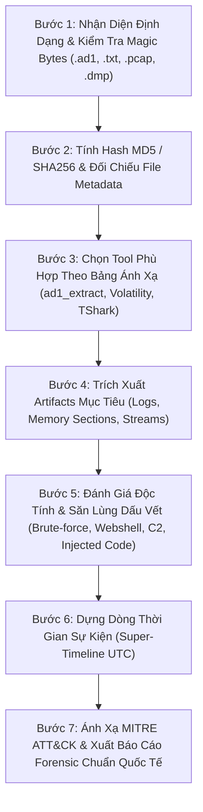

# V-AutoFor Digital Forensics & Incident Response (DFIR) Standard Operating Procedure

> [!CAUTION]
> **QUY TẮC BẮT BUỘC SỐ 1 - SỬ DỤNG TOOL MCP CHUYÊN DỤNG (KHÔNG DÙNG POWERSHELL / BASH):**
> 1. AI **TUYỆT ĐỐI KHÔNG** dùng lệnh PowerShell hoặc Bash thông thường (như `Get-Content`, `type`, `cat`, `dir`, `Select-String`,...) để đọc hay phân tích các tệp tin bằng chứng số. Các lệnh shell thông thường **không thể phân tích nhị phân chuẩn SANS FOR508** và **không gửi dữ liệu đo kiểm về ForBrain**.
> 2. Mọi thao tác phân tích tệp tin bằng chứng **BẮT BUỘC PHẢI GỌI CÁC CÔNG CỤ MCP CỦA FORBRAIN**:
>    - File `.ad1` ➔ Gọi `ad1_list` và `ad1_extract`.
>    - Hashing & Metadata `.txt` ➔ Gọi `verify_evidence_integrity`.
>    - File PE (`.exe`, `.dll`, `.sys`) ➔ Gọi `pe_analyze` và `sigcheck_file`.
>    - Windows Prefetch (`.pf`) ➔ Gọi `parse_prefetch`.
>    - Windows Amcache (`Amcache.hve`) ➔ Gọi `parse_amcache`.
>    - Windows Shimcache (`SYSTEM`) ➔ Gọi `parse_shimcache`.
>    - Bảng $MFT ➔ Gọi `parse_mft`.
>    - Windows Event Logs (`.evtx`) ➔ Gọi `parse_evtx`.
>    - Shellbags (`UsrClass.dat` / `NTUSER.DAT`) ➔ Gọi `parse_shellbags`.
>    - Shortcuts (`.lnk`) ➔ Gọi `parse_lnk`.
>    - Jumplists (`*Destinations-ms`) ➔ Gọi `parse_jumplists`.
>    - SRUM (`SRUDB.dat`) ➔ Gọi `parse_srum`.
>    - Linux Logs (`auth.log`, `syslog`, `.bash_history`) ➔ Gọi `analyze_linux_logs`.
>    - Memory Dump (`.raw`, `.dmp`, `.vmem`) ➔ Gọi `volatility_*`.
>    - Network PCAP (`.pcap`, `.pcapng`) ➔ Gọi `tshark_*`.
> 3. Mỗi lệnh gọi MCP Tool này sẽ **ngay lập tức bắn dữ liệu Telemetry về ForBrain (Port 5000)** để người dùng theo dõi và kiểm tra output trực tiếp theo thời gian thực!

This skill governs the autonomous and paired forensic investigation methodology of the **V-AutoFor** AI Platform. Whenever analyzing evidence, forensic samples, triage packages, memory dumps, or packet captures, the AI **MUST** rigorously follow this standard operating procedure.

---

## 1. International Forensic Standards & Frameworks

The AI agent must ground all analyses, hypotheses, and conclusions in recognized global standards:
* **ISO/IEC 27037 (Evidence Handling):** Strict guidelines for identification, collection, acquisition, and preservation of digital evidence (integrity, non-destructive read-only analysis, verifiable chain of custody).
* **RFC 3227 (Order of Volatility):** Always prioritize volatile evidence (RAM, network state) before non-volatile artifacts (disk, logs).
* **NIST SP 800-86:** Guide to Integrating Forensic Techniques into Incident Response.
* **SANS FOR508 & FOR500:** Advanced Incident Response, Threat Hunting, and OS Artifact Analysis.
* **MITRE ATT&CK Matrix for Enterprise:** Every discovered suspicious artifact must be mapped to its corresponding Tactic (`TA00xx`) and Technique (`Txxxx`).

---

## 2. Quy Trình 3 Bước Triage Đầu Tiên: Nhận Diện - Băm Hash - Đánh Giá Độc Tính

### BƯỚC 1: Xác Định Đây Là File Gì (File Format & Magic Bytes Identification)
Trước khi phân tích, AI phải xác định chính xác bản chất của file bằng chữ ký nhị phân (Magic Bytes / File Header) và file metadata đi kèm:
1. **Kiểm tra File Header / Magic Bytes:**
   - `.ad1`: Bắt đầu bằng chuỗi header `ADSEGMENTEDFILE` (AccessData FTK Imager Logical Image).
   - `.E01`: Header `EVF` (Expert Witness Format / EnCase).
   - `.pcap`: Magic bytes `d4 c3 b2 a1` hoặc `a1 b2 c3 d4`.
   - `.pcapng`: Magic bytes `0a 0d 0d 0a` (PCAP Next Generation).
   - `.dmp` / Memory Dump: Header `PAGEDUMP` (Windows Crash Dump) hoặc raw physical memory.
   - `.evtx`: Header `ElfFile\x00` (Windows Event Log).
   - `.pf`: Header `SCCA` (Windows Prefetch).
   - `PE / Executable`: Header `MZ` (`4D 5A`) tại offset 0.
   - `ELF / Linux binary`: Header `\x7fELF` (`7F 45 4C 46`).
2. **Đọc File Companion Metadata (.txt, .log, .info):**
   - File `.ad1.txt` hoặc `.E01.txt` được FTK Imager tạo ra tự động khi trích xuất.
   - Phải đọc file này để nắm:
     * Công cụ thu thập (FTK Imager version).
     * Bằng chứng nguồn (Source Partition, filesystem ext4, NTFS).
     * Các thư mục nguồn được trích xuất (Custom Content: e.g. `/boot`, `/var/log`, `/root`).
     * Checksum gốc do điều tra viên ghi nhận (MD5, SHA1).

---

### BƯỚC 2: Tính Toán & Xác Minh Hash (Integrity & Chain of Custody)
Tính toàn vẹn của bằng chứng là nguyên tắc bất di bất dịch trong Forensic:
1. **Tính toán đồng thời 3 hàm băm:**
   - **MD5:** Tương thích với các biên bản thu giữ cũ và FTK Imager report.
   - **SHA-1:** Kiểm tra toàn vẹn truyền thống.
   - **SHA-256:** Chuẩn hiện đại chống va chạm mã băm (NIST FIPS 180-4).
2. **Đối chiếu với Companion Metadata:**
   - So sánh MD5/SHA-1 vừa tính với dòng `[Computed Hashes]` trong file `.txt`.
   - Nếu khớp 100%: Xác nhận *"Evidence Integrity Verified - No tampering or corruption"*.
   - Nếu lệch: Phải cảnh báo nghi ngờ file bị hỏng hoặc bị sửa đổi trong quá trình truyền tải.

---

### BƯỚC 3: Đánh Giá Độc Tính Sơ Bộ (Malicious Triage & Threat Assessment)
AI thực hiện quét và săn lùng chỉ số độc hại theo các hướng:
1. **Đối với Artifact Log Linux (`auth.log`, `syslog`, `.bash_history`):**
   - **SSH Brute-Force:** Đếm số lần `Failed password for ... from <IP>`. Tìm dòng `Accepted password for root from <IP>` sau chuỗi brute-force.
   - **Web Shell & Backdoor:** Quét chuỗi nhạy cảm: `eval(base64_decode`, `system($_GET`, `passthru`, `c99`, `r57`, `b374k`, `weevely`.
   - **Persistence:** Kiểm tra `/etc/crontab`, `/var/spool/cron`, `/etc/rc.local`, systemd service lạ.
   - **Bash History Hunting:** Lệnh tải mã độc (`curl`, `wget`, `nc`, `python -c "import socket..."`), lệnh xóa vết (`history -c`, `rm -rf /var/log`, `shred`).
2. **Đối với Artifact Windows (EVTX, Registry, Prefetch):**
   - **Event ID 4625 (Failed Logon) ➔ 4624 (Logon Type 3/10):** Dấu hiệu Password Spraying hoặc Brute-Force.
   - **Event ID 7045 / 4697 (Service Installation):** Cài đặt Backdoor service.
   - **Event ID 4688 / Sysmon Event 1:** LOLBAS commands (`certutil -urlcache`, `bitsadmin /transfer`, `powershell -enc`).
3. **Đối với Memory Dump (RAM):**
   - Dùng `volatility_malfind` tìm tiến trình chứa shellcode `PAGE_EXECUTE_READWRITE`.
   - Dùng `volatility_pstree` tìm tiến trình mồ côi hoặc cha-con bất thường (`cmd.exe` đẻ từ `w3wp.exe` hoặc `word.exe`).
4. **Đối với Network PCAP:**
   - Dùng `tshark_dns_queries` tìm DGA, DNS Tunneling.
   - Dùng `tshark_http_requests` / `tshark_tls_sni` tìm C2 Beaconing (kết nối lặp lại theo chu kỳ với IP/domain đáng ngờ).

---

## 3. Bảng Ánh Xạ: Định Dạng File Nào ➔ Dùng Tool Gì (Format-to-Tool Matrix)

| Định dạng file | Loại bằng chứng | Công cụ tương ứng (MCP Tool) | Mục tiêu phân tích |
| :--- | :--- | :--- | :--- |
| **`.ad1`** | Logical Container (FTK Imager) | `ad1_list`, `ad1_extract` | Đọc cấu trúc cây thư mục, bung toàn bộ file/log ra disk để phân tích. |
| **`.txt` / `.log` đi kèm** | Metadata Report | `verify_evidence_integrity` | Lấy hash gốc, nguồn phân vùng, thời gian tạo, xác minh tính toàn vẹn ISO/IEC 27037. |
| **`.exe`, `.dll`, `.sys`** | PE Binaries / Malware | `pe_analyze`, `sigcheck_file` | Đọc PE header, section entropy (UPX/packer), imphash, kiểm tra chữ ký số. |
| **`.pf`** | Windows Prefetch | `parse_prefetch` | Đếm số lần thực thi, 8 mốc thời gian chạy gần nhất, DLLs được nạp (Evidence of Execution). |
| **`Amcache.hve`** | Windows Amcache | `parse_amcache` | SHA-1 của chương trình, đường dẫn gốc, thời gian thực thi đầu tiên (First Execution). |
| **`SYSTEM` hive** | AppCompatCache | `parse_shimcache` | Lịch sử tương thích ứng dụng (1024 binary), kích thước file và timestamp. |
| **`$MFT`** | Master File Table | `parse_mft` | Phân tích MACB timestamps ($SI vs $FN) để phát hiện Timestomping, file bị xóa. |
| **`.evtx`** | Windows Event Log | `parse_evtx` | Sự kiện đăng nhập (4624/4625), dịch vụ mới (7045), PowerShell 4104, Sysmon. |
| **`UsrClass.dat`, `NTUSER.DAT`** | Shellbags | `parse_shellbags` | Bằng chứng duyệt thư mục GUI trong Windows Explorer của kẻ tấn công. |
| **`.lnk`** | Shortcut Files | `parse_lnk` | Đường dẫn file gốc, serial ổ đĩa, địa chỉ MAC của máy tạo shortcut. |
| **`*Destinations-ms`** | Jumplists | `parse_jumplists` | Lịch sử file vừa mở theo từng ứng dụng. |
| **`SRUDB.dat`** | SRUM | `parse_srum` | Lịch sử 30-60 ngày về lượng byte mạng gửi/nhận và thời gian chạy ứng dụng. |
| **`auth.log`, `syslog`, `.bash_history`** | Linux Logs | `analyze_linux_logs` | Tự động phát hiện SSH Brute-Force, leo quyền sudo, lệnh bash kẻ tấn công đã gõ. |
| **`.E01`, `.raw`, `.dd`, `.vmdk`** | Full Disk Image | `aift` (Dissect Engine) | Mở file hệ thống NTFS/ext4, phân tích partition table, mount filesystem. |
| **`.dmp`, `.vmem`, `.raw` (RAM)** | Memory Dump | `volatility_*` | `volatility_pslist`, `pstree`, `malfind`, `netscan`, `cmdline`. |
| **`.pcap`, `.pcapng`, `.cap`** | Network Capture | `tshark_*` | `tshark_conversations`, `tshark_dns_queries`, `tshark_http_requests`, `tshark_tls_sni`. |
| **Persistence (Khởi động)** | Autostarts | `autoruns_triage` | Quét toàn bộ điểm cắm chốt Run/RunOnce, Services, Scheduled Tasks. |

---

## 4. Trình Tự Thực Hiện Forensic Step-by-Step

---

## 5. Quy Tắc Ứng Xử Chuyên Nghiệp Khi Điều Tra

* **Evidence-First Rule:** Tuyệt đối không phỏng đoán vô căn cứ. Mọi nhận định về kẻ tấn công phải trích dẫn bằng chứng cụ thể (dòng log, timestamp, IP nguồn, file path, hoặc hash).
* **Non-Destructive Principle:** Chỉ đọc bằng chứng trên bản sao hoặc phân tích Read-Only. Không bao giờ chỉnh sửa file gốc trong `E:\Hunting-Forensics\Evidence`.
* **Precision in Timestamps:** Mọi mốc thời gian sự kiện trong báo cáo phải ghi rõ timezone (ưu tiên `UTC` hoặc `UTC+7` ghi rõ).
* **Clear Attribution & IOCs:** Phân định rõ ràng giữa hành vi bình thường của hệ thống và hành vi xâm nhập có chủ đích của tin tặc.
